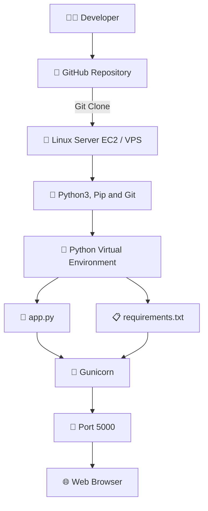

# 🚀 Python Web Application Deployment Using GitHub, Linux & Gunicorn

## 📌 Introduction

In this project, I deployed a Python web application on a Linux server using GitHub and Gunicorn. I uploaded the application files to GitHub, updated the server, installed the required packages, configured a Python virtual environment, and installed the application dependencies.

Finally, I installed Gunicorn to run the Python application as a web server and accessed the deployed application through the server's public IP address.

## 🏗️ Architecture Diagram



## 📂 Project Structure

```text
python-project/
├── app.py
├── requirements.txt
└── venv/
```

- 🐍 **app.py** — Main Python application file.
- 📋 **requirements.txt** — Contains the required Python packages.
- 📁 **venv/** — Isolated Python virtual environment.
- 🦄 **Gunicorn** — Runs the application as a WSGI server.

## 🛠️ Step-by-Step Implementation

### 📤 Step 1: Upload Project Files to GitHub

I uploaded these files to my GitHub repository:

- 📄 `app.py`
- 📋 `requirements.txt`

### 🔄 Step 2: Update the Linux Server

```bash
sudo apt update
sudo apt upgrade -y
```

### 🧰 Step 3: Install Required Packages

```bash
sudo apt install -y python3 python3-pip git python3-venv
```

- 🐍 **Python3** — Runs Python applications.
- 📦 **Python3-pip** — Installs Python packages.
- 🐙 **Git** — Clones the project from GitHub.
- 🔧 **Python3-venv** — Creates a virtual environment.

### 📥 Step 4: Clone the GitHub Repository

Replace the URL with your own GitHub repository URL.

```bash
git clone https://github.com/YOUR-USERNAME/YOUR-REPOSITORY.git
cd YOUR-REPOSITORY
```

### 🐍 Step 5: Create and Activate a Virtual Environment

```bash
python3 -m venv venv
source venv/bin/activate
```

Check the Python version:

```bash
python3 --version
```

### 📝 Step 6: Update requirements.txt

I updated the required package version to `8.1.8` in `requirements.txt`.

Example (only if this is the actual package used in your project):

```text
PACKAGE-NAME==8.1.8
```

⚠️ **Important:** Confirm the actual package name and version. Do not use `Flask==8.1.8` unless that is the version you really installed and it exists for your environment.

### 📦 Step 7: Install Project Dependencies

```bash
python -m pip install --upgrade pip
pip install -r requirements.txt
```

### 🦄 Step 8: Install Gunicorn

```bash
pip install gunicorn
gunicorn --version
```

### ⚙️ Step 9: Run the Application Using Gunicorn

For a Flask application where `app.py` contains a Flask application object named `app`:

```bash
gunicorn --bind 0.0.0.0:5000 app:app
```

- 🚀 `gunicorn` — Starts the Gunicorn server.
- 🌐 `--bind 0.0.0.0:5000` — Listens on port 5000 on all network interfaces.
- 📄 `app:app` — The Python file is `app.py` and the application object inside it is named `app`.

Keep the process running while testing the application.

### 🌐 Step 10: Access the Application

Open this URL in your browser:

```text
http://YOUR-SERVER-PUBLIC-IP:5000
```

🔐 Make sure port `5000` is allowed in the server firewall or AWS Security Group, if applicable.

### 🔍 Run Gunicorn in the Background

For a basic test, you can run Gunicorn in the background:

```bash
nohup gunicorn --bind 0.0.0.0:5000 app:app > app.log 2>&1 &
```

Check the process:

```bash
ps aux | grep gunicorn
```

View the logs:

```bash
tail -f app.log
```

💡 For production, configure Gunicorn with `systemd` and consider using Nginx as a reverse proxy.

## 📊 Add an Architecture Image

Upload your architecture image to the repository in an `images` folder, named `python-deployment-architecture.png`, then add this Markdown:

```markdown

```

## ✅ Project Outcome

- ✅ Uploaded `app.py` and `requirements.txt` to GitHub.
- 🔄 Updated the Linux server.
- 🧰 Installed Python3, pip, Git, and virtual environment support.
- 📥 Cloned the project from GitHub.
- 🐍 Created and activated a Python virtual environment.
- 📝 Updated the required package version in `requirements.txt`.
- 📦 Installed project dependencies.
- 🦄 Installed Gunicorn.
- 🌐 Deployed and accessed the application through the server's public IP and port.

## 🎯 Skills Learned

`🐧 Linux` · `🐍 Python` · `🐙 Git` · `🐙 GitHub` · `📁 Virtual Environment` · `📦 Pip` · `🦄 Gunicorn` · `🌐 Web Application Deployment`

## 👨‍💻 Conclusion

This hands-on project helped me understand how to deploy a Python web application on a Linux server using GitHub, dependency management, virtual environments, and Gunicorn. I look forward to learning more about automation, CI/CD pipelines, and DevOps tools.

---

### 🔖 Tags

#Python #Linux #GitHub #Gunicorn #AWS #DevOps #CloudComputing #HandsOnLearning
